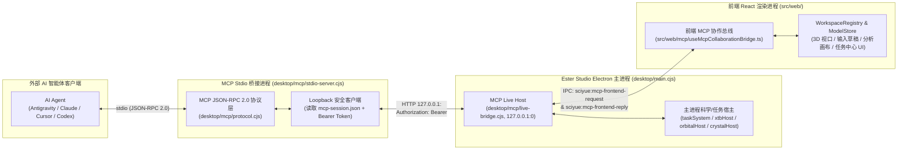

# Ester Studio 人机同屏协作 MCP 架构与分阶段实施路线图 (`MCP_COLLABORATION_ROADMAP.md`)

本文档完整记录 **Ester Studio 人机同屏协作（Human-Agent Co-Pilot）MCP 封装层** 的总体架构、核心交互闭环、6 大类 16+ 个 MCP 工具的详细规格契约，以及 7 个渐进开发阶段的路线图与验收标准。

> **持久化说明**：由于根目录下的 `ACTIVE_TASK.md` 会在每次分支合并回 `main` 时被自动重置为空模板，本文档作为跨阶段、防上下文压缩遗忘的**永久性权威设计蓝图**保存在 `docs/` 目录中。每开启一个新阶段时，均以本文档对应章节为基准填写当期的 `ACTIVE_TASK.md`。

---

## 1. 核心设计理念：人机同屏协作（Human-Agent Co-Pilot）

传统的命令行计算化学工具或纯后台无头（Headless）MCP 服务存在“黑盒操作”痛点：AI 在后台盲猜原子编号、配置参数，人类用户无法直观看到分子构象、冻结位点、二面角扫描方向或电荷分布是否合理。

**Ester Studio MCP 的核心定位是“人机同屏协作”**：
1. **同一个状态源（Single Source of Truth）**：AI Agent 通过 MCP 调用的每一个操作，都直接作用于正在运行的 Ester Studio 桌面端主进程（`desktop/main.cjs`）与前端权威工作台（`WorkspaceShell.tsx` / `WorkspaceRegistry` / `TaskCenter`）；
2. **全程可视化同屏反馈**：
   - AI 导入文件 → 前端 3D 视口立即弹出分子/晶体模型；
   - AI 旋转视角、打开原子序号标签并截图自检 → 用户在屏幕上同步看到分子旋转与高亮标注，AI 通过多模态视觉确认构型无误；
   - AI 冻结原子、设置二面角扫描、配置 Gaussian/ORCA/xTB 参数 → 前端自动切换到「计算输入」面板，所有表单与生成的 `.gjf` / `.inp` 脚本实时更新，用户可随时鼠标微调接管；
   - AI 提交计算任务 → 前端「任务中心」立即出现任务卡片，实时展示 Slurm/本地运行状态、SCF 收敛曲线与输出日志；
   - AI 触发波函数与结果分析 → 前端自动切换到「结果分析」面板，3D 分子实时染上 RESP/CM5 电荷色阶或显示轨道/ESP 等值面，同时将结构化数值表返回给 AI。

---

## 2. 总体通信架构

### 关键架构与安全约束
1. **零额外第三方依赖**：MCP 协议解析、本地 Loopback 通信、鉴权全部基于 Node.js 原生模块（`node:http`、`node:crypto`、`node:readline`、`node:fs`）构建。
2. **跨平台本机安全鉴权**：
   - 主进程启动时绑定 `127.0.0.1:0`（OS 分配随机空闲端口），生成 256-bit 随机 Bearer Token；
   - 将 `{ port, token, pid, version, startedAt }` 写入用户数据目录（或 `ESTER_MCP_SESSION_FILE` 环境变量指定路径）下的 `mcp-session.json`（文件权限 `0o600`）；
   - 任何未携带正确 Bearer Token 的请求一律返回 `401 Unauthorized`。
3. **Preload 最小权限原则**：
   - `desktop/preload.cjs` 仅暴露 `onMcpFrontendRequest` 和 `replyMcpFrontendRequest` 两个受控通道，绝不向渲染进程暴露原始 `ipcRenderer` 或 Node.js 文件系统对象。

---

## 3. 核心人机同屏交互 6 步闭环

1. **步骤 1（窗口就绪与文件导入）**：
   - AI 调用 `ester_window_manage` 确认主窗口在线，调用 `ester_open_file` 导入结构文件（如 `SDF` / `PDB` / `CIF` / `POSCAR` / `XYZ`）；
   - 前端自动创建模型标签页并在 3D 视口居中渲染。
2. **步骤 2（深度几何内省 + 多角度旋转截图视觉自检）**：
   - AI 调用 `ester_get_structure_info` 获取全部原子的 1-based 序号（`1..N`）、`atomId`、坐标、成键、配位环境、用户在界面中框选的原子（`selected`）以及**自动发现的可旋转单键二面角（Rotatable Torsions）**；
   - AI 调用 `ester_viewport_camera` 开启原子序号显示（`showAtomIndices: true`）并旋转视角（如对齐主惯量轴 `principal-inertia`、晶胞轴 `a/b/c` 或上下左右旋转 45°），随后调用 `ester_viewport_screenshot` 获取 PNG 截图；
   - 多模态 AI 直接通过截图视觉核对分子构型、表面吸附位点及目标原子序号，必要时调用 `ester_measure_geometry` 精确测量特定键长（`B`）、键角（`A`）、二面角（`D`）并在视口中高亮显示。
3. **步骤 3（结构编辑、冻结与扫描约束设置）**：
   - AI 调用 `ester_edit_structure`（修改电荷/多重度、几何清理 `geometry_clean`、RDKit 力场优化、切 Slab 晶面）和 `ester_set_constraints`（冻结指定原子 `frozenAtoms`，或设置键长/键角/二面角的 `freeze` / `scan` 步长与步数）；
   - 前端 3D 视口实时显示冻结锁标记（🔒）与内坐标扫描标注。
4. **步骤 4（创建并配置计算任务）**：
   - AI 调用 `ester_recommend_method` 检查泛函与基组元素覆盖度，调用 `ester_configure_calculation` 配置 Gaussian 或 ORCA 任务；
   - 前端自动切换到「计算输入（Input）」面板，所有控件与底部 `.gjf` / `.inp` 脚本预览实时同步，用户可随时查看或微调。
5. **步骤 5（启动/提交任务并联动任务中心）**：
   - AI 调用 `ester_run_local_xtb`（本地紧束缚优化/构象搜索）或 `ester_submit_task`（提交至任务中心的本机或远程 SSH/Slurm 环境，支持自动提交或弹出预填确认框）；
   - 用户在前端「任务中心（Task Center）」实时看到 Agent 创建的任务卡片、排队/运行状态、SCF 能量曲线与实时日志。
6. **步骤 6（结果可视化渲染、波函数分析与数据导出）**：
   - 任务完成后，AI 调用 `ester_open_result_analysis` 在前端「结果分析（Analysis）」面板打开结果，并调用 `ester_run_wavefunction_analysis` 触发 Multiwfn 计算 **RESP / CM5 / ADCH / Bader 电荷**、键级矩阵或分子轨道/ESP 等值面；
   - 前端 3D 分子实时染上电荷色阶或渲染轨道等值面，AI 可再次调用 `ester_viewport_screenshot` 截图展示给用户，并调用 `ester_export_artifact` 导出电荷表与优化后坐标（供下游 GROMACS / Sobtop / ACPYPE 衔接使用）。

---

## 4. 完整 MCP 工具规格清单（6 大类 + 基础底座）

### 0. 基础诊断与状态探活（Foundation Tools）
| 工具名 | 参数概览 | 返回值与前端同步行为 | 复用底层模块 |
| :--- | :--- | :--- | :--- |
| `ester_ping` | `{ message?: string }` | 返回 MCP Server、Electron 主进程与前端渲染进程的在线连通状态与往返延迟。 | `desktop/mcp/live-bridge.cjs` |
| `ester_status` | `{ includeDocuments?: boolean }` | 返回应用版本、平台架构、当前活动模块（`modeling`/`advanced`/`input`/`analysis`）、任务中心打开状态及所有打开文档的摘要列表（`documentId`、`label`、`revision`、原子数、电荷/多重度、是否周期性结构）。 | `WorkspaceShell.tsx`、`workspace-registry.ts` |

### 1. 第一类工具：窗口与文件管理（Window & File Tools）
| 工具名 | 参数概览 | 返回值与前端同步行为 | 复用底层模块 |
| :--- | :--- | :--- | :--- |
| `ester_window_manage` | `{ action: 'list' \| 'switch-module' \| 'activate-document' \| 'create-document' \| 'close-document' \| 'open-task-center' \| 'close-task-center' \| 'detach-window' \| 'dock-window' \| 'focus-window', module?: WorkspaceModule, documentId?: string, discardUnsaved?: boolean }` | 管理主工作台模块切换、新建/激活/关闭指定文档标签页、打开/关闭任务中心抽屉、弹出/收起独立模型窗口，并返回最新工作台状态。 | `WorkspaceShell.tsx`、`workspace-documents.cjs`、`useTaskWorkspace.tsx` |
| `ester_open_file` | `{ path: string, target?: 'modeling' \| 'analysis' \| 'auto' }` | 将本地结构或量化输出文件（`XYZ`/`PDB`/`MOL`/`SDF`/`CIF`/`POSCAR`/`GJF`/`ORCA`/`FCHK`/`LOG`/`OUT`/`CP2K`）导入前端并自动激活对应标签页，返回新建文档的 `documentId`、原子数、化学式及导入诊断信息。 | `launch-import.cjs`、`WorkspaceShell.tsx` (`importFiles`)、`parsers.ts` |

### 2. 第二类工具：3D 视口相机控制与视觉截图（Viewport & Vision Tools）
| 工具名 | 参数概览 | 返回值与前端同步行为 | 复用底层模块 |
| :--- | :--- | :--- | :--- |
| `ester_viewport_camera` | `{ documentId?: string, preset?: 'principal-inertia' \| 'X' \| 'Y' \| 'Z' \| 'a' \| 'a*' \| 'b' \| 'b*' \| 'c' \| 'c*', rotateStep?: 'left' \| 'right' \| 'up' \| 'down', rotateDelta?: { dx: number, dy: number }, zoom?: number, resetView?: boolean, display?: { showAtomIndices?: boolean, showElementLabels?: boolean, showBondLengths?: boolean, showAxes?: boolean, showCell?: boolean, style?: string } }` | 控制前端 3D 视口相机旋转、按主惯量轴或晶胞轴标准对齐、缩放复位，并可一键开启/关闭原子序号标签（`1 C`, `2 O` 等）以便截图核对。前端 3D 画布实时响应。 | `src/web/modeling/render/camera.ts`、`view-frame.ts`、`ModelViewport.tsx` |
| `ester_viewport_screenshot` | `{ documentId?: string, width?: number, height?: number, includeAnnotations?: boolean, transparent?: boolean, savePath?: string }` | 将当前文档的 3D 视口（含分子、晶胞、原子序号标签、冻结/测量标记、轨道等值面或电荷色标条）渲染导出为 PNG 图像。同时返回 MCP 标准 `image/png` Base64 内容块（供多模态 AI 直接看图）及可选落盘路径。 | `src/web/results/export-image.ts` (`canvasPng`)、`ModelViewport.tsx` |

### 3. 第三类工具：深度结构内省、几何测量与建模约束（Structure & Geometry Tools）
| 工具名 | 参数概览 | 返回值与前端同步行为 | 复用底层模块 |
| :--- | :--- | :--- | :--- |
| `ester_get_structure_info` | `{ documentId?: string, includeAtoms?: boolean, includeBonds?: boolean, includeRotatableTorsions?: boolean, selectedOnly?: boolean }` | 返回指定文档的完整拓扑与几何内省数据： 1. **原子列表**：`index` (1-based `1..N`)、`atomId`、`element`、`x,y,z` ($\text{\AA}$)、`formalCharge`、配位邻居序号、`selected`（用户在界面是否选中）、`frozen`（是否冻结）； 2. **化学键列表**：两端原子序号、键长（$\text{\AA}$）、键级、是否芳香键/环内键； 3. **可旋转二面角列表**：自动识别出的所有可旋转单键 `[atom1, atom2, atom3, atom4]`、当前二面角度数及旋转带动原子集； 4. **晶胞与周期性信息**。 | `src/core/structures.ts`、`src/modeling/conformers/geometry.ts`、`src/core/periodic.ts` |
| `ester_measure_geometry` | `{ documentId?: string, measurements?: { type: 'B' \| 'A' \| 'D', atoms: number[] }[], neighborShell?: { centerAtom: number, cutoffAngstrom?: number }, highlightInViewport?: boolean }` | 精确计算任意 2 原子距离/键长（`B`，单位 $\text{\AA}$）、3 原子键角（`A`，单位 $^\circ$）、4 原子二面角（`D`，单位 $^\circ$），或查询指定原子周围截断半径内的配位键长与键角分布。若 `highlightInViewport: true`，前端 3D 视口同步高亮显示所测量的原子与角度标签。 | `src/core/tasks.ts` (`coordinateValue`)、`src/core/builder-geometry.ts` |
| `ester_edit_structure` | `{ documentId?: string, operation: 'set-electronic-state' \| 'select-atoms' \| 'geometry-clean' \| 'forcefield-optimize' \| 'crystal-supercell' \| 'crystal-slab' \| 'delete-atoms' \| 'set-bond-order' \| 'undo' \| 'redo', params: Record<string, unknown> }` | 对当前模型执行修改（设置电荷/多重度、修改前端选区、快速几何清理、RDKit `MMFF94s`/`UFF` 优化、晶体扩胞/切 Slab 表面、删除原子/改键级或撤销重做），前端 3D 视口与 Undo 栈实时同步更新。 | `ModelStore`、`geometry_clean.py`、`forcefield-adapter.ts`、`crystal-modeling.cjs` |
| `ester_set_constraints` | `{ documentId?: string, frozenAtoms?: number[], clearFrozenAtoms?: boolean, coordinates?: { type: 'B' \| 'A' \| 'D', atoms: number[], action: 'freeze' \| 'scan', value?: number, stepSize?: number, steps?: number }[], clearCoordinates?: boolean }` | 设置或更新冻结原子列表（支持按 1-based 原子序号或直接冻结当前用户在前端选中的原子）以及内坐标冻结/柔性扫描（`Scan`）定义。前端 3D 视口与输入面板实时同步显示冻结与扫描约束。 | `src/modeling/constraints.ts`、`src/modeling/application/canonical-freezes.ts` |

### 4. 第四类工具：计算方法推荐与任务配置（Input Configuration Tools）
| 工具名 | 参数概览 | 返回值与前端同步行为 | 复用底层模块 |
| :--- | :--- | :--- | :--- |
| `ester_recommend_method` | `{ documentId?: string, engine?: 'gaussian' \| 'orca', task: TaskId }` | 根据当前分子元素组成、电荷多重度与计算任务类型（`sp`/`opt`/`freq`/`optfreq`/`ts`/`scan`/`irc`/`td`/`nmr`），返回推荐泛函、色散校正、基组及元素基组覆盖度校验结果。 | `src/core/catalog.ts`、`src/core/basis.ts`、`src/core/orca/catalog.ts` |
| `ester_configure_calculation` | `{ documentId?: string, engine: 'gaussian' \| 'orca', settings: Record<string, unknown>, switchToInputView?: boolean }` | 在前端为指定文档创建或更新 Gaussian / ORCA 计算配置草稿（任务类型、泛函、基组、色散、溶剂模型与溶剂、核数、内存、高级选项等）。前端自动切换到「计算输入（Input）」面板，实时渲染表单与生成的完整 `.gjf` / `.inp` 脚本，并返回脚本内容与 `validateJob` / `validateOrca` 校验结果。 | `src/core/gaussian.ts`、`src/core/orca/build.ts`、`App.tsx` |

### 5. 第五类工具：任务启动与任务中心监控（Task Execution & Center Tools）
| 工具名 | 参数概览 | 返回值与前端同步行为 | 复用底层模块 |
| :--- | :--- | :--- | :--- |
| `ester_run_local_xtb` | `{ documentId?: string, calculation: 'singlepoint' \| 'optimize' \| 'conformer-search', method?: 'gfn2' \| 'gfn0' \| 'gfnff', solvent?: string, maxSteps?: number }` | 在前端触发本机 `xTB` 单点能、几何优化或可旋转键构象搜索。前端实时播放优化帧轨迹与能量收敛过程，完成后返回收敛结构、能量与 Wiberg 键级。 | `desktop/xtb-host.cjs`、`desktop/conformer-sampling-host.cjs` |
| `ester_submit_task` | `{ documentId?: string, mode?: 'auto-submit' \| 'open-dialog', environmentId?: string, taskName?: string, cores?: number, memoryGB?: number }` | 将当前配置好的 Gaussian / ORCA 任务提交至「任务中心」（`open-dialog` 模式在前端弹出预填好的提交窗口供用户点确认；`auto-submit` 模式直接提交至指定的本地或远程 SSH/Slurm 环境并在前端刷新任务中心）。返回 `taskId` 与运行状态。 | `desktop/task-system/host.cjs`、`useTaskWorkspace.tsx` |
| `ester_task_manage` | `{ action: 'list-tasks' \| 'task-detail' \| 'read-log' \| 'stop-task' \| 'list-environments', taskId?: string, tailLines?: number }` | 查询「任务中心」中的任务列表、实时运行状态（排队/运行中/已完成/失败）、SCF 能量与优化步数监控、读取输出日志尾部，或停止正在运行的任务。 | `desktop/task-system/host.cjs` |

### 6. 第六类工具：结果可视化分析与数据导出（Analysis & Export Tools）
| 工具名 | 参数概览 | 返回值与前端同步行为 | 复用底层模块 |
| :--- | :--- | :--- | :--- |
| `ester_open_result_analysis` | `{ source: { taskId?: string, filePath?: string }, panel?: 'energy' \| 'charges' \| 'bonds' \| 'orbitals' \| 'surface' \| 'interaction' \| 'vibrations' \| 'excited' \| 'reactivity' }` | 将任务中心已完成的任务快照或本地输出/波函数文件（`.log`/`.out`/`.fchk`/`.molden`/`.hess`）载入前端「结果分析（Analysis）」工作区并激活对应分析子面板，返回能量、收敛状态、虚频诊断、热力学量与谱峰摘要。 | `WorkspaceShell.tsx` (`postprocess.read`)、`scientific-reader.ts` |
| `ester_run_wavefunction_analysis` | `{ documentId?: string, kind: 'charges' \| 'bond-orders' \| 'composition' \| 'reactivity' \| 'orbitals', method: string, orbitalKey?: string, renderInViewport?: boolean }` | 调用内置 `Multiwfn` 宿主执行计算并同步在前端 3D 视口渲染： - **原子电荷**（`resp` / `cm5` / `adch` / `hirshfeld` / `hirshfeld-i` / `bader` / `mulliken` / `lowdin` / `scpa`）； - **键级矩阵**（`mayer` / `wiberg-lowdin` / `laplacian` / `fuzzy`）； - **反应性与前线轨道**。 前端 3D 分子实时染上电荷色阶并展示色标条/数据表，同时向 AI 返回完整结构化数值表（可直接用于生成 GROMACS `.itp` 拓扑）。 | `desktop/orbital-host.cjs`、`wavefunction-analysis.cjs`、`AnalysisControls.tsx` |
| `ester_export_artifact` | `{ documentId?: string, kind: 'structure' \| 'input-script' \| 'analysis-table', format?: 'xyz' \| 'extxyz' \| 'cif' \| 'poscar' \| 'gjf' \| 'inp' \| 'tsv', outputPath: string }` | 将当前模型的坐标结构、生成的量化输入脚本或计算出的原子电荷/键级数据表导出保存到指定路径，便于衔接 `Sobtop`、`ACPYPE` 或 `GROMACS` 等下游工具。 | `src/core/structure-export.ts`、`AnalysisControls.tsx` (`analysisText`) |

---

## 5. 七阶段渐进开发路线图与验收标准

每个阶段均遵循 `AGENTS.md` 规范：**更新 `ACTIVE_TASK.md` → 独立分支开发 + 100% 单元测试通过 → 启动子 Agent 进行实际功能测试 → 启动 `code-review` 多子代理独立盲审并签发收据 → 用户确认后合并回 `main`**。

| 阶段 | 分支名称 | 核心交付模块与工具 | 阶段完成标志 |
| :--- | :--- | :--- | :--- |
| **阶段 1** | `feat/mcp-foundation-bridge` | `desktop/mcp/protocol.cjs`、`desktop/mcp/live-bridge.cjs`、`desktop/mcp/stdio-server.cjs`、`src/web/mcp/useMcpCollaborationBridge.ts`；工具：`ester_ping`、`ester_status` | **已完成 (已合并至 main)** |
| **阶段 2** | `feat/mcp-window-and-file-tools` | 第一类工具：`ester_window_manage`、`ester_open_file` | **已完成** |
| **阶段 3** | `feat/mcp-viewport-and-vision-tools` | 第二类工具：`ester_viewport_camera`、`ester_viewport_screenshot` | 待启动 |
| **阶段 4** | `feat/mcp-structure-and-geometry-tools` | 第三类工具：`ester_get_structure_info`、`ester_measure_geometry`、`ester_edit_structure`、`ester_set_constraints` | 待启动 |
| **阶段 5** | `feat/mcp-input-config-tools` | 第四类工具：`ester_recommend_method`、`ester_configure_calculation` | 待启动 |
| **阶段 6** | `feat/mcp-task-execution-tools` | 第五类工具：`ester_run_local_xtb`、`ester_submit_task`、`ester_task_manage` | 待启动 |
| **阶段 7** | `feat/mcp-analysis-and-export-tools` | 第六类工具：`ester_open_result_analysis`、`ester_run_wavefunction_analysis`、`ester_export_artifact` | 待启动 |
