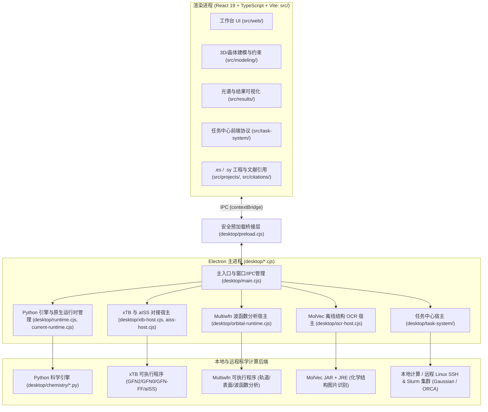

# Ester Studio 项目架构与目录结构详解 (`PROJECT_STRUCTURE.md`)

本文档详细介绍 **Ester Studio (v2.0.2)** 的代码组织结构、各子系统职责以及渲染进程与主进程/科学计算引擎之间的协作方式，便于后续进行功能开发和 macOS 平台移植。

---

## 1. 整体架构图

---

## 2. 前端模块详解 (`src/`)

前端基于 **React 19 + TypeScript + Vite** 构建，运行在标准 Chromium 渲染进程中（除 `src/web/task-system/EnvironmentSettings.tsx` 与 `environment-assistant.ts` 中的本机/SSH 私钥路径格式校验需随 macOS 适配放开 POSIX 绝对路径外，其余 UI 与可视化组件均跨平台通用）。

| 目录 | 核心职责与关键文件 |
| :--- | :--- |
| `src/core/` | 基础化学数据模型、元素周期表、单位换算、结构库溯源校验（`structure-library-provenance.ts`）。 |
| `src/web/` | 应用程序主界面、菜单栏、面板布局、3D 视口（基于 `3dmol`）、2D 结构编辑器集成（基于 `ketcher-react` / `indigo-ketcher` / `kekule`）。 |
| `src/modeling/` | 分子与晶体结构编辑、几何测量与约束（`constraints.ts`）、工作台布局配置（`workbench-layout.ts`）、高级计算参数适配器（`advanced/forcefield-adapter.ts`、`advanced/xtb-result.ts`）。 |
| `src/results/` | 量子化学计算结果解析（Gaussian `.log`/`.fchk`、ORCA `.out`/`.hess`、xTB 输出、`.molden`、`.cube`），振动模式动画，以及 IR、Raman、UV-Vis、ECD、NMR 等谱图渲染。 |
| `src/task-system/` | 任务中心前后端共享协议（`protocol.ts`）、JSON Schema（`schema-v1.json`）及输出文件流式读取解析器（`reading/`）。 |
| `src/projects/` | `.es`（新默认格式）与 `.sy`（兼容旧格式）工程文件的打包、解包、结果快照（`result-snapshot.ts`）管理。 |
| `src/citations/` | 根据当前工程使用的方法学、泛函、基组与外部软件自动汇总并导出规范学术引用（`collect.ts`）。 |

---

## 3. Electron 主进程与宿主层详解 (`desktop/`)

`desktop/` 目录采用 CommonJS (`.cjs`) 编写，负责管理原生进程、文件系统安全边界与外部科学计算工具调度：

### 3.1 主进程核心与运行时契约
- `desktop/main.cjs`：应用生命周期管理、窗口创建、文件打开关联、所有 IPC Channel 的注册中心。
- `desktop/preload.cjs`：由 `scripts/prepare-preload.mjs` 注入生成的代码块与手写桥接逻辑组成，向渲染进程暴露受控 API。
- `desktop/runtime.cjs`：负责定位并启动 Python 科学计算引擎（开发态优先读取环境变量 `SCIYUE_PYTHON` 执行 `desktop/chemistry/engine.py`；打包态调用通过 `runtime_launcher.py` 冻结生成的 `engine.exe` 或 `engine`）。
- `desktop/current-runtime.cjs` & `desktop/native-capabilities.cjs`：管理并校验本地打包运行时（Python 引擎、xTB、OCR）的身份清单与能力开关。

### 3.2 Python 科学计算引擎 (`desktop/chemistry/`)
通过 `engine.py`（及打包入口 `runtime_launcher.py`）统一分发子任务，底层依赖 `numpy`、`scipy`、`rdkit`、`ase`、`spglib`、`tblite`：
- **几何与成键**：`geometry_clean.py`（快速几何清理）、`hybrid_geometry.py`、`bond_perception.py`、`empirical_worker.py`。
- **晶体建模**：`crystal_modeling.py`、`crystal_worker.py`（空间群识别、超胞构建、晶面切割 Slab 生成）。
- **分子动力学与构象搜索**：`dynamics.py`、`dynamics_native_md.py`、`conformer_sampling.py`、`conformer_gfn0.py`、`conformer_gfnff.py`、`conformer_native_metadynamics.py`。
- **过渡态与反应路径**：`advanced_path.py`（NEB / Dimer 过渡态搜索）。
- **周期性紧束缚计算**：`xtb_periodic.py`、`xtb_periodic_bonds.py`（调用 `tblite`）。
- **波函数与电子结构后处理**：`orbitals.py`、`wavefunction_analysis.py`、`surface_analysis.py`、`interaction_analysis.py`（IGMH/IRI）、`hirshfeld_analysis.py`、`bader_analysis.py`、`excitation_analysis.py`、`reactivity_analysis.py`。

### 3.3 外部科学计算组件宿主
- **xTB & aISS 宿主**（`desktop/xtb-runtime.cjs`、`desktop/xtb-host.cjs`、`desktop/aiss-host.cjs`）：管理本地半经验量子化学计算（单点能、几何优化、频率、扫描）与分子间对接（aISS）。
- **波函数分析宿主**（`desktop/orbital-runtime.cjs`）：定位并调度外部 `Multiwfn` 可执行程序生成 Cube 网格与电子结构数据。
- **离线结构识别 OCR**（`desktop/ocr-runtime.cjs`、`desktop/ocr-host.cjs`、`desktop/ocr/molvec.cjs`）：通过内置 JRE 调用 `molvec-0.9.8-jar-with-dependencies.jar` 将文献截图中的化学结构式转换为 Molfile/SMILES。

### 3.4 任务中心 (`desktop/task-system/`)
负责管理本地及远程量子化学计算任务（Gaussian、ORCA）：
- `host.cjs` & `store.cjs`：任务状态机、持久化队列与恢复逻辑。
- `environments.cjs` & `environment-profiles.cjs`：计算环境配置（`local` 本地环境、`wsl` 环境、`ssh` 远程服务器环境）。
- `transports/`：
  - `local.cjs`：本机命令与文件操作传输层。
  - `ssh.cjs`：基于 `ssh2` 的远程 SFTP/Exec 传输层。
  - `posix.cjs`：针对远程 Linux 节点的 Shell 探测与文件流读取脚本封装。
  - `wsl.cjs`：Windows Subsystem for Linux 专用桥接层（仅 Windows）。
- `execution/`：
  - `runner.cjs` / `posix-runner.cjs` / `slurm.cjs`：本地进程、远程后台守护进程以及 Slurm 作业调度器（`sbatch`/`squeue`/`scancel`）执行引擎。
  - `gaussian-windows.cjs`：Windows 版 `g16w.exe` 专用监控器（仅 Windows）。
- `platform/`：
  - `process-identity.cjs`：宿主机进程存活与启动时间戳验证（防 PID 复用误杀）。
  - `credentials.cjs`：基于 Electron `safeStorage`（Windows DPAPI / macOS Keychain）的 SSH 凭据加密存储。

---

## 4. 构建与同源生成脚本 (`scripts/`)

在启动开发或构建前，`npm run prepare:runtime`（即 `scripts/prepare-runtime-assets.mjs`）会按顺序执行以下同源生成步骤：
1. `prepare-preload.mjs`：将 `desktop/preload-managed-results.cjs` 内联同步至 `desktop/preload.cjs`。
2. `3dmol-bond-primitives.cjs`：对 `node_modules/3dmol` 应用键级渲染补丁。
3. `prepare-chemistry.mjs`：收集 `public/` 下的结构库、外观预览图及 2D 组件许可证至 `.cache/desktop-public-*`。
4. `prepare-workbench-preferences.mjs`：从 `src/modeling/workbench-layout.ts` 编译生成 `desktop/workbench-layout-runtime.cjs`。
5. `prepare-structure-provenance.mjs`：从 `src/core/structure-library-provenance.ts` 编译生成 `desktop/structure-library-provenance-runtime.cjs`。
6. `prepare-conformer-batch-runtime.mjs`：使用 `rolldown` 将前端力场与 xTB 结果校验模块打包为 `desktop/conformer-batch-science-runtime.cjs`。
7. `prepare-task-system.mjs`：使用 `rolldown` 将 `src/task-system/` 编译打包为 `desktop/task-system/protocol.cjs` 与 `reading-runtime.cjs`。
